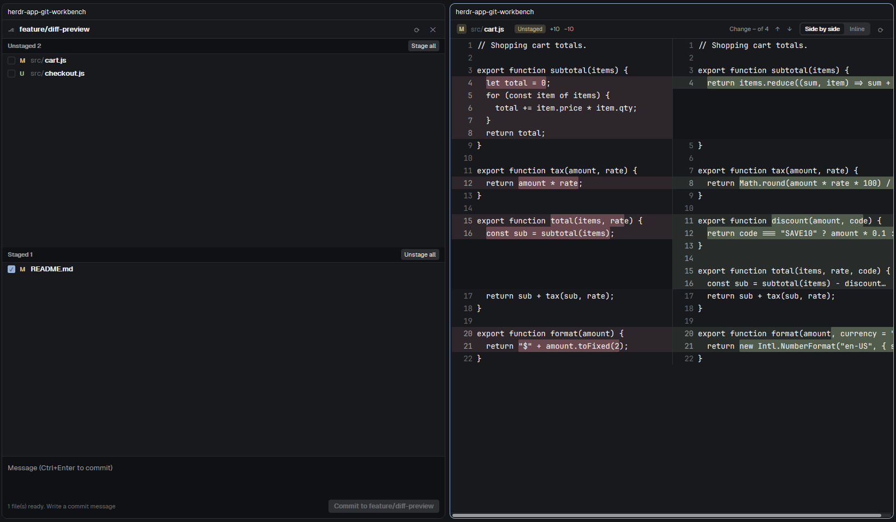

# Git Workbench

Git source control and a visual diff for [Herdr Desktop](https://herdr.dev).



- **Source Control panel:** a column beside your terminals, shown and hidden with
  `Ctrl+Shift+G`. It follows the active space's repository and shows the branch,
  its upstream and ahead/behind counts, any merge, rebase, cherry-pick or revert in
  progress, and your changes in two lists: Unstaged (Conflicts, Changes, Untracked)
  and Staged. Tick a row to stage or unstage it. Hover a row and click 🗑 to discard
  it (you are asked first). Write a message in the commit box and press
  **Commit to &lt;branch&gt;** or `Ctrl+Enter`.
- **Diff view:** click a change to open it in its own tab. Side-by-side and inline
  modes, line numbers, added/removed/modified tints with intra-line detail, change
  navigation, and handling for long lines, large files, binary files, renames and
  new or deleted files. Clicking the same change again goes back to its tab.

The panel keeps itself up to date: it watches the repository, refreshes after every
Workbench action, and refreshes when it or the window gets focus. Workbench commands
that change the repository run one at a time.

It needs Git. If `git` is not on your `PATH`, the Workbench also looks in Git for
Windows' standard install folders.

**What it does on your machine:** it runs `git` (through Herdr's `exec`) in the
active space's folder, and reads files under that repository's `.git` folder. It
does not reach the network.

## Install

These steps work for a person or an agent. They keep your own layout and keys.
Steps 2 to 4 change Herdr's state, so an agent asks before each one.

### 1. Copy the mod in as a real folder

The mod folder is `~/.config/herdr-app/mods/herdr-app-git-workbench`. It must be a
**real folder**: a directory junction or symlink breaks Herdr's hot reload.

From a clone of this repository (needs Node 22):

```sh
npm run sync
```

That copies only the runtime files (`main.js`, `mod.json`, `keys.json`, `src/`
without `src/adapters/`). Copying the whole repository folder by hand also works;
leave out `RECIPE.md` and `preview.png`. Then check it loads:

```sh
herdr-app check ~/.config/herdr-app/mods/herdr-app-git-workbench
```

`mod.json` is `{ "place": "none", "focusable": true }`: Herdr does not dock the
panel anywhere by itself. Steps 2 and 3 put it in your layout.

### 2. Use a personal layout

Herdr's own layouts (`main`, `terminals`, `win98`) are read-only, so the panel
needs a personal layout. `herdr-app status` (or `shared("layout")` in a mod) names
the layout that is shown.

- If it is already a personal layout (a file you made in
  `~/.config/herdr-app/layouts/`), use it and go to step 3.
- If it is a shipped one, **ask first**, then clone it:

  ```sh
  herdr-app do layout.clone '{"name":"main","as":"my-layout"}'
  ```

  This switches to the clone. Tell the person that the clone is theirs and does
  not get later changes to `main`, and that `Ctrl+Shift+L` switches between
  layouts. The Workbench column fits `main`'s shape; for another shipped layout,
  find a row to put it in by hand.

Want to keep the shipped layout? Skip steps 2 and 3 and use the
[fallback](#fallback-keep-the-shipped-layout).

### 3. Add the `git-workbench` column, once only

Read the personal layout, `~/.config/herdr-app/layouts/<name>.json`.

1. **If any node already has `"id": "git-workbench"`, stop here:** the column is
   already there. Never add it twice.
2. Find the row with `"id": "work-body"`. In its `children`, right after the node
   with `"id": "panel"` (Herdr's Files/Changes column), insert:

   ```json
   {
     "id": "git-workbench",
     "type": "block",
     "hidden": true,
     "size": { "px": 340 },
     "min": 280,
     "max": 900,
     "content": { "mod": "herdr-app-git-workbench" }
   }
   ```

3. With that layout shown, apply the whole edited tree:

   ```sh
   herdr-app do layout.set '{"layout": <the edited tree>}'
   ```

The column starts hidden. The id `git-workbench` is what `Ctrl+Shift+G` and the
panel's ✕ button toggle, so keep it exactly.

### 4. Merge `keys.json`

The mod's `keys.json` has one key:

```json
{ "global": { "ctrl-shift-g": "layout.toggle:git-workbench" } }
```

Merge it into `~/.config/herdr-app/keys.json`: add the section and key if they are
missing. **If the person already uses `ctrl-shift-g`, ask** before replacing it, or
pick another key with them. To bind it for one layout only, put it in a
`"layout:<name>"` section instead of `global`.

Note for the person: Herdr adds new default shortcuts only to an untouched
`keys.json`. After any edit, the whole file is theirs, and later defaults must be
added by hand.

Press `Ctrl+Shift+G`. The Source Control panel appears beside your terminals.

### Fallback: keep the shipped layout

Without a personal layout, open the panel as a pane beside the focused one:

```sh
herdr-app do pane.split '{"direction":"right","mod":"herdr-app-git-workbench"}'
```

or bind that to a key in `keys.json`:

```json
{ "global": { "ctrl-shift-g": { "command": "pane.split", "args": { "direction": "right", "mod": "herdr-app-git-workbench" } } } }
```

The pane belongs to its tab. Diff views open in new tabs, so the panel leaves the
screen when one opens; switch back to its tab to see it again. The panel's ✕ button
hides the layout column and does nothing in a pane: close the pane with
`pane.close` instead. Each key press opens another pane.

To try the panel without any change, `herdr-app do mod.open
'{"name":"herdr-app-git-workbench"}'` opens it as an overlay (run it again to
close it).

### Uninstall

Delete the mod folder, remove the `git-workbench` node from your layout (or switch
back with `Ctrl+Shift+L` and delete the clone's file), and remove the key from
`keys.json`.

## Keys

### Global

| Key | Does |
|---|---|
| `Ctrl+Shift+G` | Show or hide the Source Control panel (`layout.toggle:git-workbench`) |

### Source Control panel

These work while the panel has focus (click it, or move to it with Herdr's
`pane.go` keys).

| Key | Does |
|---|---|
| `↑` / `↓` | Move the selected row |
| `Space` | Stage or unstage the selected row; on a Conflict, mark it resolved |
| `Enter` | Open the selected row's Diff view |
| `Delete` | Discard the selected row, after you confirm (Changes and Untracked only) |
| `Tab` | Move to the commit box |
| `Ctrl+Enter` | In the commit box: commit, same as the button |

The list keys do nothing while you type in the commit box.

### Diff view

| Key | Does |
|---|---|
| `n` / `F7` | Next change |
| `p` / `Shift+F7` | Previous change |
| `←` / `→` / `Home` | Pan long lines left, right, back to the start |
| `i` | Switch between side-by-side and inline (remembered for every Diff view) |
| `r` | Reload |

## Mod commands (optional bindings)

Herdr's command palette does not list mod commands, so these are reachable only
from `keys.json` or `herdr-app do`. None is bound by default.

| Command | Does |
|---|---|
| `herdr-app-git-workbench.refresh` | Re-read the repository now |
| `herdr-app-git-workbench.stage_all` | Stage every unstaged change (same as **Stage all**) |
| `herdr-app-git-workbench.unstage_all` | Unstage everything (same as **Unstage all**) |
| `herdr-app-git-workbench.commit` | Commit, exactly like the **Commit to &lt;branch&gt;** button |

Bind any of them in `keys.json`, for example:

```json
{ "global": { "ctrl-shift-f5": "herdr-app-git-workbench.refresh" } }
```

or run one from a terminal:

```sh
herdr-app do herdr-app-git-workbench.stage_all
```

Pick keys you don't already use. Avoid plain `ctrl+<letter>` (terminal programs
need them), `ctrl+alt` (AltGr on Windows) and `alt+↑`/`alt+↓` (Herdr's agent keys).

`herdr-app-git-workbench.discard` also exists. The discard confirmation dialog
sends it; don't bind it.

## Limitations

- **No syntax highlighting** in the Diff view. Herdr gives mods no tokenizer, so
  lines show added/removed tints only.
- **No 3-way merge.** Conflicts are listed and shown as Git's combined diff.
  Resolve them in your editor or terminal, then tick the row to mark the Conflict
  resolved.
- **Commands are ignored while the panel is hidden.** Herdr delivers
  `herdr-app-git-workbench.<command>` only to copies that are shown, so a bound
  key does nothing until you show the panel with `Ctrl+Shift+G`.
- The panel follows the **active space's folder** (where its new terminals start),
  not the folder of the focused terminal. If a space's folder is not the project
  you work in, the panel shows that folder's repository, or "No repository".
- One repository at a time: the one for the active space.
- Spaces on other machines are not tested. Herdr's file watch is local only, so a
  remote space refreshes only on actions, focus and the ⟳ button.
- A running Git command cannot be cancelled; actions stay disabled until it ends
  or times out.
- Out of scope for this version: fetch, pull and push, amend, history, branches,
  hunk staging, stash and worktree management.

## Runtime checks

The automated tests cover the core (Git, status, the queue, diffs). The UI is
checked by hand in the running app. Results for Herdr Desktop 0.1.18 on Windows:

| Check | Result |
|---|---|
| `Ctrl+Enter` in the commit box reaches the `Input` and commits | Pending: needs a person at the keyboard |
| `pane.go` moves focus onto the panel, and the panel keys work | Pending: needs a person at the keyboard |
| How many events `watchFolder` delivers for one change (e.g. a save, a `git commit`) | A save: 1 batch (now and then 2). `git add`: 2 batches. `git commit`: 1 batch of about 20 paths (objects, locks, refs, logs, index). Each burst gives one refresh (400 ms debounce). On Windows the paths come in verbatim form (`\\?\C:\...`); the filter accepts it. |
| `"place": "none"`: showing a personal layout does not auto-dock a second copy | Pass: a personal layout with the `git-workbench` block shows that one copy only; `main` shows none |

## Development

The mod runs from a copy in `~/.config/herdr-app/mods/herdr-app-git-workbench`,
kept in step with this repo by a sync script. A directory junction does not
work: Herdr's hot reload ignores saves made behind one.

```sh
npm test         # core tests: node --test against temporary Git repositories
npm run dev      # mirror the mod files, then copy on every save (hot reload)
npm run sync     # one-off mirror
herdr-app check ~/.config/herdr-app/mods/herdr-app-git-workbench
herdr-app do mod.open '{"name":"herdr-app-git-workbench"}'   # show it as an overlay
herdr-app shot shot.png
```

`src/core/` is plain JavaScript with no Herdr imports and is what the tests drive;
`src/ui/` and `main.js` are the Herdr views. See `GLOSSARY.md` for the terms used
in the code.
