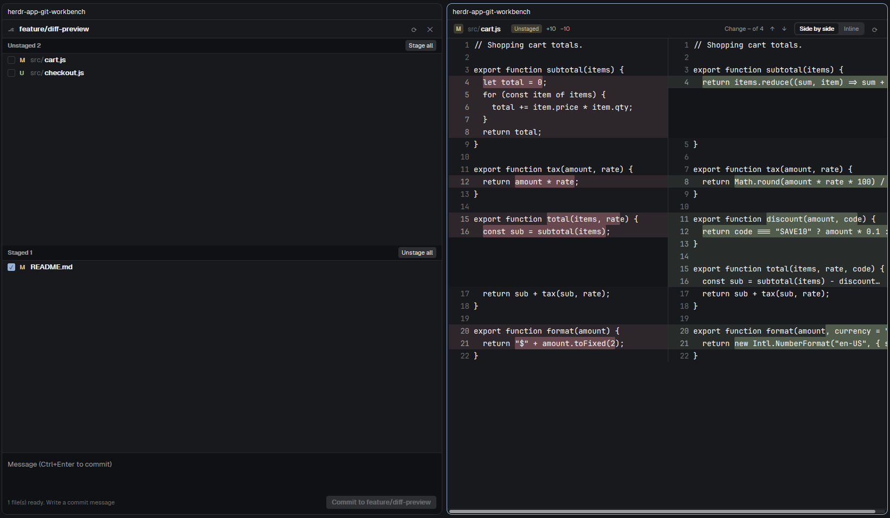

# Git Workbench

A Source Control panel docked beside the terminals, and a Diff view in its own tab
for each changed file. The panel follows the active space's Git repository: branch,
upstream, ahead/behind, the changes in Unstaged and Staged lists with checkboxes,
and a commit box, with a Graph of history and Fetch/Pull/Push below. Clicking a
change, or a file of a commit, opens a side-by-side (or inline) diff.

## What you see

- **Source Control panel:** a 340 px column (min 280, max 900) to the right of
  Herdr's Files/Changes panel (hidden until toggled), or a pane opened from the
  command palette. Top to bottom:
  - Top bar: `⎇ branch → upstream`, an `↑a ↓b` pill when there is an upstream, an
    operation badge (Merging, Rebasing, Cherry-picking, Reverting), then ⟳ (refresh)
    and ✕ (hide). A detached HEAD shows "detached HEAD" in `ansi3` and the short oid.
  - A running strip ("Staging…", "Committing…") while a Git command runs, and a red
    error strip (summary, with a Details toggle) after a failed action.
  - **Unstaged** header with **Stage all**, a red Conflicts banner when there are
    Conflicts, then the Conflicts, Changes and Untracked rows. **Staged** header with
    **Unstage all**, then the staged rows.
  - Each row: checkbox, status letter (`M`/`T` `ansi3`, `A` and untracked `U`
    `ansi2`, `D` and conflict `!` `ansi1`, `R` `ansi4`), file name, dim folder.
    Hovering an unstaged row shows 🗑. The selected row has a `raised` background.
  - Commit box at the bottom: a 3-row textarea, a status line ("2 files ready",
    "Nothing staged", "Resolve 1 conflict first"), and **Commit to &lt;branch&gt;**.
  - **Graph** below a draggable divider (id `scm-graph-split`; starts at up to ⅔ of
    the viewport). Header: ▾/▸ collapse, "Graph", a spinner while reloading, and
    `Auto | All | Current`. Toolbar: **Fetch**, **Pull ↓n**, **Push ↑n** or
    **Publish** (primary one in `accent`), ⌖ go to current, ⟳ reload. One virtual
    list: 40 px commit rows (lane cell, chevron, up to 3 badges then `+N`, subject,
    bold for HEAD; then short oid, author, relative date, `merge`), a detail block
    and 22 px file rows under an expanded commit, and **Load more…**. Lanes are 2 px
    paths in `ansi12, ansi13, ansi11, ansi14, ansi10, ansi9` by lane index, curved
    at forks and merges; HEAD has a ringed dot, a merge a hollow one. Badges: ◉ HEAD
    (outlined, bold), ⎇ local (lane colour), ☁ remote (muted), ◆ tag (`ansi3`).
    Other states: "Loading history…", "No commits yet", an error with **Retry**.
  - Other states: "Git not found", "No repository" (with the folder), loading.
- **Diff view:** a tab named `Δ <file>` (`Δ <file> (staged)` for the staged side).
  Header: status chip, dim folder and bold name, a Staged/Unstaged/Untracked/Conflict
  badge, `+N −M`, "Change k of N" with ↑/↓, and a "Side by side | Inline" switch.
  Body: one virtual list of rows, `ceil(font_size × 1.6)` px each, with line numbers;
  added rows `ansi2` + `1c` alpha, removed `ansi1` + `1c`, the changed middle of a
  modified line at `55` alpha, an empty half in `canvas`, gap rows in `raised`, and a
  3 px `accent` bar on the current change. A thin notice band for binary, new,
  deleted and untracked files, a large-file fallback, or a mode change.

## How it behaves

- The panel follows the active space's `folder` (not the focused terminal's cwd).
  It refreshes from a debounced (400 ms) watch of the work tree and the git dir,
  after every Workbench action, and when the space changes, the window becomes
  active or the panel gets focus. No timed polling.
- Ticking a row stages it (`git add`) or unstages it (`git restore --staged`, or
  `git reset` on an unborn branch). Ticking a Conflict marks it resolved. Repository
  changing commands go through one queue per repository (linked worktrees share
  their main repository's queue); actions are disabled while one runs.
- 🗑 opens Herdr's `confirm` dialog; Confirm restores the file (`git restore
  --worktree`) or deletes an untracked file (`git clean -f`). Cancel does nothing.
- Commit runs `git commit -m <message>` with hooks; a hook failure shows in the
  error strip. `Ctrl+Enter` in the textarea does the same as the button.
- Panel keys: `↑`/`↓` select, `Space` stage/unstage, `Enter` open diff, `Delete`
  discard (Changes and Untracked). Off while typing. `Tab`/`Shift+Tab` cycle
  Change list → commit box → Graph.
- Graph: `git log -z --topo-order --decorate=full --decorate-refs-exclude=refs/stash`
  at the loaded count (50, +50 per Load more), replacing the whole model each time.
  Revisions: Current `HEAD`; Auto `HEAD @{upstream}` (Upstream left out when unset,
  gone or detached); All `HEAD --branches --remotes --tags`; unborn HEAD runs
  nothing. `origin/HEAD` gets no badge. The Ref filter is stored per Repository.
  A load is a read beside the queue (60 s timeout), so the Change groups stay
  usable. Changed files come from a rename-detecting `diff-tree` against the first
  parent (a root commit as a root), cached by oid; a file opens a Diff target from
  the first parent to the commit.
- Graph reloads: a watch batch touching `HEAD` (git dir) or `refs/`, `packed-refs`
  or `reftable/` (common dir); after commit; after every sync; on ⟳. Expanded
  commits, selection, scroll and count survive; vanished oids drop quietly.
- Graph keys: `↑`/`↓` select commits and file rows, `→`/`Space` expand, `←`
  collapse or go to the commit, `Enter` toggle or open the file's diff.
- Sync runs on the queue with the 600 s timeout, never forces and never
  autostashes. Fetch: `git fetch --all`. Pull: `--no-autostash --no-edit` plus the
  mode from `branch.<name>.rebase` / `pull.rebase` and `pull.ff`, else `--ff-only`;
  the divergence message's one-off buttons pass `--no-rebase --ff` or `--rebase`.
  Conflicts are read from `ls-files --unmerged` after the pull. Push: plain `git
  push` with an Upstream, else Publish `push --set-upstream <remote> HEAD`.
  Failures are classified by Git's text (auth, rejected push, no Upstream,
  divergence, would overwrite) into the error strip, with Git's output in Details.
  After 15 s the running label adds the sign-in hint. Status and the Graph refresh
  after every sync.
- Diff keys: `n`/`F7`, `p`/`Shift+F7`, `←`/`→`/`Home` pan, `i` mode, `r` reload.
  The mode is shared by every Diff view and remembered.
- Clicking a change whose Diff tab is open selects that tab instead of opening
  another.
- Mod commands `refresh`, `stage_all`, `unstage_all`, `commit` act only in the
  panel copy, and only while it is shown.

## Built from

- **Mod `herdr-app-git-workbench`**, `mod.json` `{ "place": "none", "focusable": true }`.
  One `View` in `main.js`; each copy picks its role from `props().view`: none or
  `"panel"` is the Source Control panel, `"diff"` (with `props().diff`, a Diff target)
  is a Diff view. Module scope holds one shared Workbench for all copies.
- `src/core/` (no Herdr imports, tested with `node --test` against real temporary
  repositories): Git runner and discovery, status parsing (`git status
  --porcelain=v2 -z --branch --untracked-files=all`), Repository snapshots, the
  command queue, watch filtering, diff loading and row building, the Graph's
  history, lane fold and key logic, and sync. It reaches Herdr
  only through a platform object `{exec, watch, readTextFile, sleep, gitCandidates,
  getSetting, setSetting}`.
- `src/ui/`: the panel, the Graph section, the Diff view, the tab registry and the
  Herdr platform.
- **`herdr` functions:** `exec`, `readTextFile`, `watchFolder`, `spaces`, `focused`,
  `panes`, `home`, `theme`, `settings`, `shared`/`setShared` (`gitwb.diffMode`, and
  `gitwb.refFilter.<repository id>` through the platform's settings),
  `nextCommand`, `openOverlay`, `run`, `checking`, `window`.
- **Commands it runs:** `tab.new`, `tab.select`, `layout.hide {id: "git-workbench"}`.
- **Shipped mods it uses:** `confirm` (discard dialog), with
  `command: {name: "herdr-app-git-workbench.discard"}`.
- **Programs:** `git` from `PATH`, else `C:\Program Files\Git\cmd\git.exe` or
  `%LOCALAPPDATA%\Programs\Git\cmd\git.exe`.
- **Layout block** (in a personal clone of `main`, `work-body` row, after `panel`):
  `{"id":"git-workbench","type":"block","hidden":true,"size":{"px":340},"min":280,"max":900,"content":{"mod":"herdr-app-git-workbench"}}`
- **`mod.json`:** `"place": "none"`, `"focusable": true`, and one `"palette"`
  entry: "Git Workbench: Open Source Control beside this pane" (`pane.split
  {direction: "right", mod: "herdr-app-git-workbench"}`). No toggle entry: on a
  layout without the column, `layout.toggle` fails with "no node".
- **No `keys.json`:** the mod binds no keys; a toggle key is the person's choice.

## Install

Follow README.md's Install section: copy the folder as a real folder, clone the
shown layout if it is a shipped one (ask first), add the `git-workbench` block with
`layout.set` only if no node has that id, then `herdr-app check`. Leave
`keys.json` alone. Fallback without a
personal layout: `pane.split {"direction": "right", "mod": "herdr-app-git-workbench"}`.
The mod runs `git` in the active space's folder and reads files under its `.git`;
it reaches the network only through Git, when the person presses Fetch, Pull, Push
or Publish. It handles no credentials (Git's credential helper does). No extra
install step for the Graph.

## Watch out

- `"place": "right"` would make Herdr auto-dock a second copy the first time a
  personal layout shows. Keep `"none"`; the install adds the block.
- Shipped layouts are read-only to structure: the block needs a personal layout.
- The mod runtime has no `setTimeout`, `process.env` or Node APIs. Timers come
  from `cx.timer` / `cx.sleep` in a host task spawned with `{owner: null}`.
- `run("tab.new")` returns null: read the new tab's id from `focused()` after it.
- `watchFolder` resolves once per batch; re-arm it. On Windows it reports `.git`
  and ignored folders too, so filter (lock files, `objects/`, logs) before refreshing.
- Mod-command arguments are dropped, and commands reach shown copies only, so the
  discard confirmation works by remembering the pending change in the panel.
- Conflicts produce a combined diff (`@@@`, two prefix columns).
- `git restore --staged` fails on an unborn branch: use `git reset -q -- <paths>`.
- `flex_shrink()` needs an argument; a `v_virtual_list` needs a definite height and
  `w_full()` rows; in a `mod.open` overlay, absolutely positioned lists collapse.
- No syntax highlighting (no tokenizer for mods), no 3-way merge.
- `exec()` can't stream or cancel: no `--progress`, and a timed-out sync loses
  Git's partial output. Git Credential Manager's window can open behind Herdr.
- Git's sync failures share exit codes; classify by text (`FAILURE_RULES` in
  `src/core/sync.js`, from git 2.45.2). Localised Git falls back to its first line.
- No commit actions, Abort/Continue or background fetch in the Graph.

## Done when

- `npm test` passes and `herdr-app check` on the mod folder reports no errors.
- The palette's "Git Workbench: Open Source Control beside this pane" opens the
  panel as a pane; with the layout column, `layout.toggle {id: "git-workbench"}`
  shows and hides it and ✕ hides it.
- In a repository with a modified, an untracked and a staged file, each is in the
  right list; ticking moves it between Unstaged and Staged, and `git status` agrees.
- Clicking a modified file opens a `Δ <file>` tab with tints and intra-line detail;
  clicking it again selects the same tab.
- 🗑 then Confirm restores the file; Cancel leaves it.
- A commit with a message empties the Staged list and the box; a failing
  `pre-commit` hook shows its output in the error strip.
- Running `git commit` in a terminal updates the panel without a click, and the
  new commit appears at the top of the Graph.
- Clicking a commit expands it with its details and files; clicking a file opens a
  `Δ <file>` tab against the first parent. `Auto | All | Current` changes the
  commits shown and is remembered after a restart.
- With a branch one commit ahead of its Upstream, **Push ↑1** is primary and pushes;
  on a new branch, **Publish** sets the Upstream. With the Upstream ahead, **Pull ↓n**
  fast-forwards.
